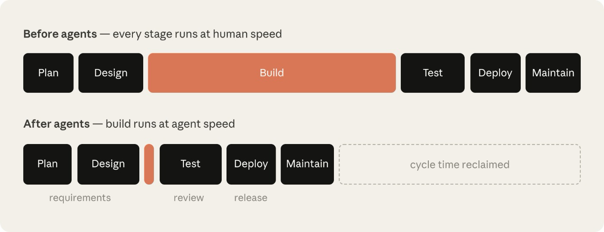
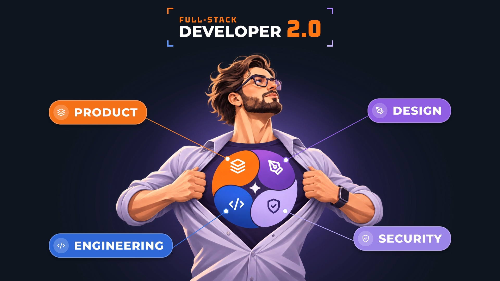
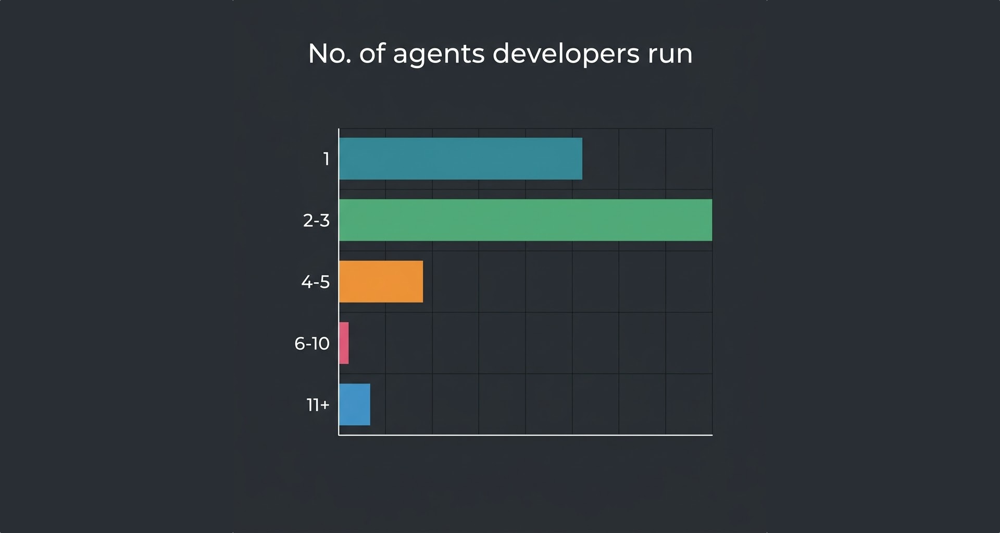



---

Almost all developers are using AI now, and some of them even call themselves
“AI-powered developers." But is it enough for the software development to be
truly transformed? For most teams, the effect is less dramatic than you might
think. Look at this post on the Claude website called
[AI-native SDLC playbook>](https://claude.com/resources/articles/the-ai-native-sdlc-playbook)
. In particular, this diagram, which shows what happens
when we can write code much faster than before:

*Task lifecycle before and after agents. Credit: [Claude>](https://claude.com/resources/articles/the-ai-native-sdlc-playbook)*

As you can see, the overall cycle time decreases, but not as much, because the
overall speed is limited by steps that humans need to take. I don't think I buy
everything in this post, but I think they correctly pointed out that when we
can write the code faster, something else becomes a bottleneck, and for most
teams, it’s communication. Code reviews, approvals, deciding what needs to be
built, figuring out the specifications, and so on.

## Who is ready for the change?

If we want to build faster, we need to change how teams operate, but who is
actually ready for the change? Teams are made of people, and different people
use AI differently. Researchers from Harvard Business School
[studied how people use AI>](https://www.hbs.edu/ris/Publication%20Files/26-036_e7d0e59a-904c-49f1-b610-56eb2bdfe6f9.pdf)
and put them in three groups: Cyborgs, Centaurs, and Self-Automators.
Cyborgs are those who work together with AI very closely. They brainstorm ideas
together, try to understand what AI is doing, push AI limits, push their own
limits, and overall, use AI to extend their own capabilities and learn new
skills.

Centaurs divide all their work into two areas—what they do themselves and what
they delegate to AI. And finally, there are self-automators, who delegate
thinking to AI. They just throw their task at it and probably do some quality
checks of the result, and that’s it. They don’t learn much in the process and
actually lose their skills that they had previously when they were doing this
work themselves. There's another term for this circulating on the internet:
"meat proxy," which is rude but, unfortunately, accurate, because such people
don't add much value on top of AI agents. Changing the team structure and
operation means that people will need to adapt and learn new skills, but not
all people who use AI actually want to learn something.

## We've seen it before

We’ve already seen something similar in the past. While most engineers chose
rather narrow specializations, like backend developers, frontend developers,
operations, quality assurance, security, and so on, there was also a movement
in the opposite direction: full-stack development. At our company, we’ve been
hiring almost exclusively full-stack developers for more than a decade now. It
wasn’t easy to find highly qualified full-stack developers, but we felt like
it was worth it because the benefits were so obvious. We can work much faster
if we eliminate that back and forth between backend developers, frontend
developers, operations, and so on. So team communication was already
a bottleneck before AI, and now it becomes even more apparent.

## Learning new skills

What AI changes in this equation is that it makes it easier to expand into
new areas and learn new skills for those people who want to do so. And once
that happens, the most natural thing for such people would be to get more
autonomy and build complete features or even projects themselves. This is what
I call Full-stack Developer 2.0: One person who can work on product, design,
engineering, and security.

Not only developers can switch to this role. For example, it could be a product
manager or a designer who wants to build things themselves. Anyone can acquire
these new skills that would allow them to build it all.

## What about taste?

A one-million dollar question: How good will people be at these new skills? For
example, let's talk about developers who want to expand into design.
Historically, designs made by developers were usually not very good, let’s put
it mildly. And now, if they ask AI to create a design without providing too
much guidance, it’ll produce an average design, at best. To create something
really good, they need to have taste.

Is it even possible to acquire taste? I personally think there’s nothing
magical about it. Taste emerges when you practice. Trying to build stuff
yourself, getting user feedback, reviewing what others did, noticing what
exactly makes good design good, and repeating that many times—this is a recipe
for becoming a good designer. No magic, just practice and trying to constantly
improve.

In our company, we let developers practice on our own projects. We also provide
coaching and help of a professional designer when they need it. And it works!
So if you want to become a better designer, or a better engineer, or a product
manager, you can, just practice.

## One-person teams

If we now have folks who can do it all, does it mean we can have one-person
teams? Yes! For some of our clients, it’s exactly that: one person who does
it all, and I would say it goes pretty good. In fact, it's not an even entirely
new idea. For example, look at the
[Indie Hackers>](https://www.indiehackers.com) community—it existed long before
AI. It's made of people who are building their product themselves, wearing all
possible hats in the process. Now, AI makes it easier to expand to other areas,
and more people can become "indie hackers." And it's not just solopreneurs; we
see the same happening in the enterprise environment, and we see it in our
company.

How powerful one person can be? Well, I think it’s a great fit for smaller
projects and early stage startups. They can build faster than teams consisting
of narrow specialists, and it’s obviously cheaper. For larger projects, we may
still need more people. Even if someone is very good at launching agents and
guiding them, they can’t scale the number of those agents indefinitely.

*Poll: How many agents you can run while paying enough attention to them?*

I posted a poll in developer chats asking people how many agents they can
comfortably run while paying enough attention to what they’re doing. For most
people, it’s just one or two, or sometimes, three agents. And even two or three
agents already require people to multitask, constantly switching from one task
to another, and quite often it doesn’t increase productivity but only adds
exhaustion. So, larger projects may still need larger teams, but if the project
isn’t so large, a one-person team might be the best fit.

## Bottom line

As I mentioned above, not everyone will move into this Developer 2.0 role, but
some people will. We at ivelum specialize in finding and training such people,
who can build it all. We provide them everything they might need, tools,
practice, coaching, and also put a certain bar on the quality of their work,
so if you hire a senior full-stack developer from us, it means they’re really
senior. And if you need such a superhero for your project —
just [get in touch](/contact/).
